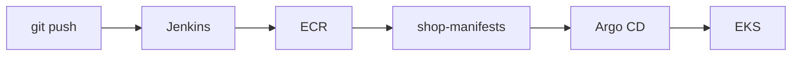

# shop 파이프라인 설명서

> 이 파일을 `docs/pipeline-guide.md`로 복사해 `(작성)` 칸을 모두 채운다. 다른 사람이 이 문서만 보고 배포·롤백할 수 있어야 한다.

## 1. 전체 흐름

(작성) 위 그림을 내 파이프라인에 맞게 고친다. 승인 지점과 카나리 단계를 그림에 넣는다.

## 2. 브랜치별 동작

| 상황 | 실행되는 단계 | 배포되는 환경 |
|---|---|---|
| 기능 브랜치 push·PR | (작성) | (작성) |
| main 병합 | (작성) | (작성) |
| 승인 버튼 클릭 | (작성) | (작성) |

## 3. 단계별 실패 시 동작

| 실패 지점 | 사용자에게 보이는 결과 | 누가·무엇을 하나 |
|---|---|---|
| 테스트 실패 | (작성) | (작성) |
| 이미지 푸시 실패 | (작성) | (작성) |
| 카나리 단계에서 오류 증가 | (작성) | (작성) |
| 승인 시간 초과 | (작성) | (작성) |

## 4. 롤백 절차

1. (작성) 카나리 진행 중일 때
2. (작성) 배포가 끝난 뒤 이전 버전으로 돌릴 때
3. (작성) 롤백 후 Git을 정리하는 방법

## 5. 측정값

| 항목 | 측정값 |
|---|---|
| push → dev 반영 | (작성) |
| 카나리 25% 단계 응답 비율 (새 버전 : 이전 버전) | (작성) |
| 카나리 50% 단계 응답 비율 | (작성) |
| abort → 전체 안정 버전 복귀 | (작성) |
| 승인 → prod 반영 | (작성) |
